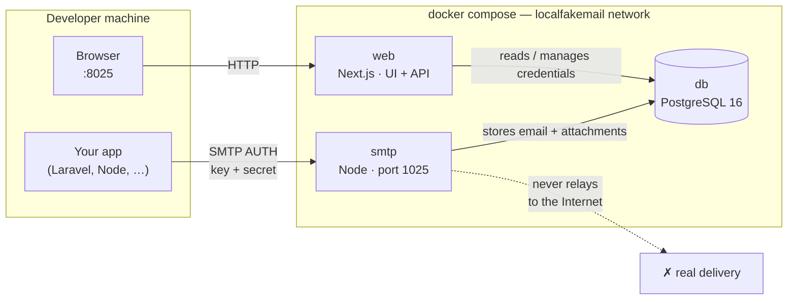

# localfakemail

[Português](README.md) · **English**

**Local SMTP capture for development — no Mailtrap.io, no cloud account, no billing.**

Self-hosted transactional email testing: your app sends SMTP as usual; localfakemail captures the messages, never delivers them to real recipients, and lets you inspect them in the UI — including HTML preview for desktop / tablet / smartphone.

Same UI extras: **Lorem Ipsum generator** and **character counter** (handy when writing templates and subject lines).

## Why this instead of Mailtrap / Mailpit / similar?

| | localfakemail | Mailtrap (cloud) | Mailpit / MailHog |
|---|---|---|---|
| Setup | `docker compose up` | Cloud account + project | Docker / binary |
| Cost | Free, local | Subscription / quotas | Free |
| Data | Stays on your machine | Vendor cloud | Local |
| SMTP auth | Per-app key/secret (generate / revoke) | Per inbox / project | Often open or basic |
| Responsive preview | Desktop · tablet · smartphone | Varies | Limited |
| Copy extras | Lorem + character counter | No | No |

**In practice:** change 4–5 variables in your app `.env`, send an email, and it shows up at `http://127.0.0.1:8025`. No signup, no cloud tokens, no risk of test mail leaving your machine.

## Getting started (2 commands)

```bash
cp .env.example .env
docker compose up -d --build
```

| What | Where |
|------|-------|
| UI + API | [http://127.0.0.1:8025](http://127.0.0.1:8025) |
| SMTP | `127.0.0.1:1025` |
| Postgres | Docker network only |

Prerequisite: Docker + Docker Compose.

## Configure in your app

1. Open **Settings** in the UI and generate a key/secret pair (optional label, e.g. `laravel-app`).
2. Copy the `.env` snippet (Laravel-ready). The secret is shown **once**.
3. Send an email — it appears in the **Inbox**.

Laravel example:

```env
MAIL_MAILER=smtp
MAIL_HOST=127.0.0.1
MAIL_PORT=1025
MAIL_USERNAME=<generated key>
MAIL_PASSWORD=<generated secret>
MAIL_ENCRYPTION=null
MAIL_FROM_ADDRESS="hello@example.com"
MAIL_FROM_NAME="${APP_NAME}"
```

Nodemailer / any SMTP client:

```js
nodemailer.createTransport({
  host: "127.0.0.1",
  port: 1025,
  secure: false,
  auth: { user: process.env.MAIL_USERNAME, pass: process.env.MAIL_PASSWORD },
});
```

If the app also runs in Docker on the same machine, use `host.docker.internal` (or the host IP) for `MAIL_HOST`. If it shares the **same** Compose stack, point at the `smtp` service on the internal network — no need to publish the SMTP port to the host.

## What you can do

### Inbox and inspection
- Message list with size, attachments, and read/unread state
- **HTML** preview (sanitized, sandboxed iframe) with desktop / tablet / smartphone viewports
- **Text** body, **raw MIME**, headers, From / To / Cc, downloadable attachments
- Delete messages; automatic retention of the latest N (`EMAIL_RETENTION_LIMIT`)

### SMTP credentials
- Multiple key/secret pairs (one app or environment per credential)
- Labels, instant revoke, secret never stored in plaintext (bcrypt)
- Ready-to-paste Laravel snippet

### HTTP API (for the UI and for scripts)
- `GET /api/emails` · `GET /api/emails/:id` · attachments · credentials
- Useful for local smoke tests and programmatic debugging

### UI extras
- **Lorem Ipsum** — paragraphs, sentences, words, or lists; counts and one-click copy (`/lorem`)
- **Character Counter** — character count plus truncated preview with ellipsis (`/counter`)

## Architecture

Three containers on the Docker network `localfakemail`. Host ports bound to `127.0.0.1` only.



| Service | Path | Role |
|---------|------|------|
| `web` | `apps/web` | UI (Inbox, Settings, Lorem, Counter) + REST API + Prisma |
| `smtp` | `apps/smtp` | SMTP server (`smtp-server` + `mailparser`); authenticates and persists |
| `db` | official image | Stores emails, attachments, and credential hashes |

Typical flow: app authenticates to SMTP → message parsed and stored → UI/API reads from Postgres → preview in Inbox. **No** external relay by default.

## Security (local by design)

- Published ports bound to `127.0.0.1` only (not `0.0.0.0`)
- SMTP requires authentication; secrets hashed with bcrypt; plaintext shown only at creation
- Sanitized HTML + sandboxed iframe
- Configurable retention — not “infinite storage”; limited by local disk
- **Do not** expose this to the internet — local development only

## Useful commands

```bash
docker compose logs -f          # logs
docker compose down             # stop
docker compose down -v          # wipe data (emails + credentials)
```

Change `WEB_PORT` / `SMTP_PORT` / `EMAIL_RETENTION_LIMIT` in `.env` if needed.

## In one sentence

Self-hosted email testing with Docker: local SMTP capture, responsive inbox preview, revocable credentials, HTTP API, and copy tools (Lorem + character counter) — no cloud, no subscription.
