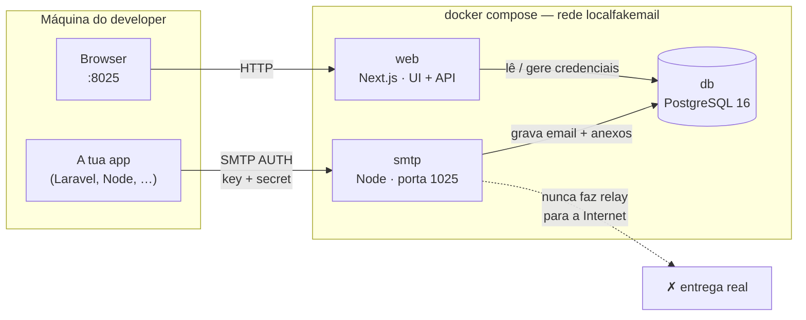

# localfakemail

**Português** · [English](README.en.md)

**Captura SMTP local para desenvolvimento — sem Mailtrap.io, sem conta cloud, sem faturação.**

Ambiente self-hosted de testes de email transacional: a tua app envia SMTP como sempre; o localfakemail captura as mensagens, nunca as entrega a destinatários reais, e deixa-te inspecioná-las na UI — com preview HTML em desktop / tablet / smartphone.

Extras na mesma UI: **gerador Lorem Ipsum** e **contador de caracteres** (úteis ao escrever templates e assuntos).

## Porque usar isto em vez de Mailtrap / Mailpit / afins?

| | localfakemail | Mailtrap (cloud) | Mailpit / MailHog |
|---|---|---|---|
| Instalação | `docker compose up` | Conta + projeto cloud | Docker / binário |
| Custo | Grátis, local | Subscrição / quotas | Grátis |
| Dados | Ficam na tua máquina | Na cloud do fornecedor | Locais |
| Auth SMTP | Key/secret por app (gerar / revogar) | Por inbox / projeto | Tipicamente aberto ou básico |
| Preview responsivo | Desktop · tablet · smartphone | Varia | Limitado |
| Extras de copy | Lorem + contador de caracteres | Não | Não |

**Na prática:** mudas 4–5 variáveis no `.env` da app, envias um email, e ele aparece em `http://127.0.0.1:8025`. Sem registo, sem tokens de cloud, sem risco de emails de teste saírem para o mundo real.

## Arranque (2 comandos)

```bash
cp .env.example .env
docker compose up -d --build
```

| O quê | Onde |
|-------|------|
| UI + API | [http://127.0.0.1:8025](http://127.0.0.1:8025) |
| SMTP | `127.0.0.1:1025` |
| Postgres | só rede Docker interna |

Pré-requisito: Docker + Docker Compose.

## Configurar na tua app

1. Abre **Settings** na UI e gera um par key/secret (podes etiquetar, ex. `laravel-app`).
2. Copia o snippet `.env` (já formatado para Laravel). O secret só é mostrado **uma vez**.
3. Envia um email — aparece na **Inbox**.

Exemplo Laravel:

```env
MAIL_MAILER=smtp
MAIL_HOST=127.0.0.1
MAIL_PORT=1025
MAIL_USERNAME=<key gerada>
MAIL_PASSWORD=<secret gerado>
MAIL_ENCRYPTION=null
MAIL_FROM_ADDRESS="hello@example.com"
MAIL_FROM_NAME="${APP_NAME}"
```

Nodemailer / qualquer cliente SMTP:

```js
nodemailer.createTransport({
  host: "127.0.0.1",
  port: 1025,
  secure: false,
  auth: { user: process.env.MAIL_USERNAME, pass: process.env.MAIL_PASSWORD },
});
```

Se a app também corre em Docker na mesma máquina, usa `host.docker.internal` (ou o IP do host) em `MAIL_HOST`. Se estiver no **mesmo** Compose, podes apontar para o serviço `smtp` na rede interna — sem expor a porta ao host.

## O que podes fazer

### Inbox e inspeção

- Lista de mensagens com tamanho, anexos e estado lido/não lido
- Preview **HTML** (sanitizado, iframe sandboxed) com viewports desktop / tablet / smartphone
- Corpo **texto**, fonte **raw MIME**, headers, From / To / Cc, anexos descarregáveis
- Apagar mensagens; retenção automática das N mais recentes (`EMAIL_RETENTION_LIMIT`)

### Credenciais SMTP

- Vários pares key/secret (uma app ou ambiente por credencial)
- Labels, revogação imediata, secret nunca guardado em texto claro (bcrypt)
- Snippet Laravel pronto a colar

### API HTTP (para a UI e para scripts)

- `GET /api/emails` · `GET /api/emails/:id` · anexos · credenciais
- Útil para smoke tests e debugging programático local

### Extras na UI

- **Lorem Ipsum** — parágrafos, frases, palavras ou listas; contagem e cópia com um clique (`/lorem`)
- **Character Counter** — conta caracteres, pré-visualiza truncagem com ellipsis (`/counter`)

## Arquitetura

Três contentores na rede Docker `localfakemail`. Portas do host só em `127.0.0.1`.



| Serviço | Path | Papel |
|---------|------|--------|
| `web` | `apps/web` | UI (Inbox, Settings, Lorem, Counter) + API REST + Prisma |
| `smtp` | `apps/smtp` | Servidor SMTP (`smtp-server` + `mailparser`); autentica e persiste |
| `db` | imagem oficial | Armazena emails, anexos e hashes de credenciais |

Fluxo típico: app autentica no SMTP → mensagem parseada e guardada → UI/API lê do Postgres → preview na Inbox. **Nenhum** relay externo por defeito.

## Segurança (local como padrão)

- Portas publicadas só em `127.0.0.1` (não em `0.0.0.0`)
- SMTP exige autenticação; secrets com bcrypt; o valor em claro só aparece na criação
- HTML sanitizado + iframe sandboxed
- Retenção configurável — não vender como “armazenamento infinito”; limitado pelo disco local
- **Não** exponhas isto à Internet — é para desenvolvimento local

## Comandos úteis

```bash
docker compose logs -f          # logs
docker compose down             # parar
docker compose down -v          # apagar dados (emails + credenciais)
```

Altera `WEB_PORT` / `SMTP_PORT` / `EMAIL_RETENTION_LIMIT` no `.env` se precisares.

## Em uma frase

Self-hosted email testing com Docker: captura SMTP local, inbox com preview responsivo, credenciais revogáveis, API HTTP, e ferramentas de copy (Lorem + contador) — sem cloud e sem subscrição.
